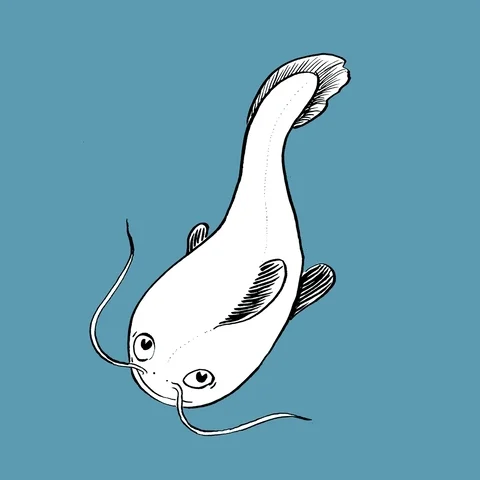

# Catfish Pet

A little catfish that swims around your desktop. It wanders on its own,
leaves a faint ripple behind its tail, and can chase your mouse cursor.



## Download (easiest, no Python needed)

1. Go to the [Releases](../../releases) page.
2. Download `CatfishPet.exe`.
3. Double-click it. That's it — the fish shows up swimming over your windows.

> Windows might show a blue SmartScreen warning since the app isn't signed.
> Click **More info** → **Run anyway**.

## Controls

| Action | What happens |
|---|---|
| Mouse wheel / `+` `-` | Make the fish bigger or smaller |
| Drag the fish | Move it somewhere (it resumes swimming after a bit) |
| `Ctrl`+`Shift`+`F` | Toggle follow-my-mouse mode (press again to go back to wandering) |
| Right-click the fish | Menu: size presets, swim speed, ripples on/off, follow mode, quit |
| `Space` | Pause / resume |
| `Q` | Quit |

To stop it, right-click the fish and pick **Quit**.

## Run from source

Needs Python 3.10+ with Pillow and numpy:

```bash
pip install pillow numpy
python fish_pet.py
```

Or on Windows just double-click `run_fish.bat`.
